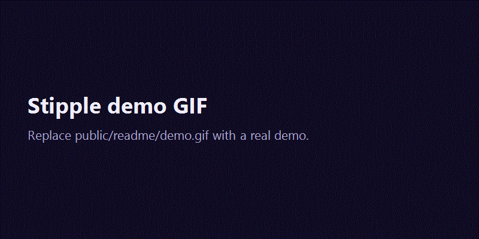

# Stipple

Your GitHub repo as a field of dots — one dot per file — with a scrollable story of its files, languages, activity and folders.



> The GIF above is a placeholder. Replace `public/readme/demo.gif` with a real demo capture.

## Features

- Scan any **public** GitHub repository from `owner/repo` or a GitHub URL.
- Boot intro that assembles the Stipple wordmark, then hands off to the live dot stage.
- Home page demo stage built from sample data.
- Live scan screen driven by server-sent events, with real pipeline stages, a sweep line and a fallback JSON request.
- Scroll story with four dot layouts: **files**, **languages**, **activity** (last 16 weeks) and **folders**.
- One dot per file up to 2,500 files; larger repos are aggregated into fewer dots with the scale shown in the legend.
- Interactive stage: hover readout, pointer wake, click shockwave, draggable folder clusters (also keyboard-nudgeable) and a Konami easter egg.
- Health score ring with six checks: README, license, tests, CI workflow, contributing guide and a commit in the last 30 days.
- Numbers for commits, contributors and packages, plus dependency chips parsed from root manifests.
- Share assets: health badge SVG, animated README card SVG, Open Graph PNG and copyable Markdown for the report link, badge, card and summary.
- Light/dark themes with a theme-wave transition, plus reduced-motion support throughout.
- Quality tiers that adapt dot count and effects to measured frame rate.
- Designed error states for invalid input, missing repos, private/missing repos, empty repos, rate limits, upstream failures and lost connections.

## How to use

1. Open the home page at `/` and type a public repo, for example `facebook/react`, or paste `https://github.com/facebook/react`.
2. Submit the form. Stipple opens `/scan/{owner}/{repo}` and streams the scan progress.
3. When the scan finishes, Stipple moves to `/r/{owner}/{repo}`.
4. Scroll through the report story. Hover dots for file details, drag folder labels in the folders layout, and use the Share section to copy assets.

### Routes

| Path | What it does |
| --- | --- |
| `/` | Home page with the repo form and demo dot stage. |
| `/scan/{owner}/{repo}` | Scan progress screen. |
| `/r/{owner}/{repo}` | Report with the scroll story and share section. |
| `/api/repo/{owner}/{repo}` | Scan data as JSON. |
| `/api/scan-progress/{owner}/{repo}` | Scan progress as server-sent events (`stage`, `done`, `error`). |
| `/api/badge/{owner}/{repo}` | Health badge SVG. An optional `.svg` suffix is accepted. |
| `/api/card/{owner}/{repo}` | Animated README card SVG. An optional `.svg` suffix is accepted. |
| `/api/og/{owner}/{repo}` | Open Graph social preview PNG. |
| `/dev/engine` | Development-only dot engine playground. Returns 404 in production. |
| `/dev/report` | Development-only report fixtures. Requires `?variant=archived`, `no-languages`, `one-file`, `monorepo` or `truncated`. Returns 404 in production. |

### Embed examples

```markdown
[](https://your-site.example/r/facebook/react)
```

```markdown
[](https://your-site.example/r/facebook/react)
```

## Tech stack

- **Next.js 16** App Router with `cacheComponents` and partial prefetching
- **React 19** and **TypeScript**
- **anime.js v4** for the intro, scroll timeline, morphs and section animations
- **Canvas 2D** dot engine with spatial indexing and quality-tier adaptation
- **CSS Modules** and CSS custom-property theme tokens
- **GitHub REST API** through a server-only typed client
- **Vitest** for unit tests and **Playwright** with `@axe-core/playwright` for end-to-end and accessibility tests

No database, auth provider or client-side GitHub token is used.

## Local setup

### Prerequisites

- Node.js 20+
- npm
- A GitHub personal access token for a higher GitHub API rate limit (public repo read access is enough)

### Install

```bash
npm install
```

### Environment

Copy the example file and fill in the values:

```bash
cp .env.example .env.local
```

On Windows PowerShell:

```powershell
Copy-Item .env.example .env.local
```

`.env.local` supports:

```bash
# GitHub personal access token (public repo read access is enough)
GITHUB_TOKEN=

# Public base URL of the site, used in links, badges and share previews
NEXT_PUBLIC_SITE_URL=http://localhost:3000
```

`GITHUB_TOKEN` is optional for local development, but unauthenticated GitHub requests share a very small rate limit. The token is read only on the server and is never exposed to the browser.

`NEXT_PUBLIC_SITE_URL` should match the URL where the app is running. It is used in share links, badge/card Markdown and metadata.

### Run

```bash
npm run dev
```

Open [http://localhost:3000](http://localhost:3000).

## Scripts

| Command | Description |
| --- | --- |
| `npm run dev` | Start the Next.js development server. |
| `npm run build` | Create a production build. |
| `npm run start` | Serve the production build. |
| `npm run lint` | Run ESLint. |
| `npm run typecheck` | Run TypeScript with `--noEmit`. |
| `npm test` | Run Vitest unit tests. |
| `npm run e2e` | Run Playwright tests; the config starts `npm run dev` if needed. |

## Project structure

```text
.
├─ src/
│  ├─ app/                  # App Router pages and API routes
│  │  ├─ page.tsx           # Home
│  │  ├─ scan/[owner]/[repo]/
│  │  ├─ r/[owner]/[repo]/
│  │  ├─ api/badge/[owner]/[repo]/
│  │  ├─ api/card/[owner]/[repo]/
│  │  ├─ api/og/[owner]/[repo]/
│  │  ├─ api/repo/[owner]/[repo]/
│  │  ├─ api/scan-progress/[owner]/[repo]/
│  │  └─ dev/               # Development-only playground routes
│  ├─ components/ui/        # Dot stage, odometer, theme toggle, route focus
│  ├─ engine/               # Canvas renderer, layouts, effects, motion, quality
│  ├─ features/
│  │  ├─ intro/             # Boot animation
│  │  ├─ scan-form/         # Repo input form
│  │  ├─ scan-screen/       # Live scan screen and flow state
│  │  ├─ report/            # Report story and sections
│  │  └─ share/             # Badge, card, OG image, Markdown and link forge
│  ├─ lib/                  # Shared types, input parsing, demo fixture, error copy
│  ├─ server/               # GitHub client, scan builder, cache and flight table
│  └─ styles/               # Theme tokens, base styles and motion styles
├─ public/
│  ├─ fonts/                # Self-hosted fonts for the OG image
│  └─ readme/demo.gif       # README demo placeholder
├─ tests/
│  ├─ unit/                 # Vitest tests
│  └─ e2e/                  # Playwright tests
├─ .env.example
├─ next.config.ts
├─ playwright.config.ts
└─ vitest.config.ts
```

## Limits and behavior

- Only **public** repositories are scanned. Private, missing and empty repositories get designed error screens.
- GitHub naming rules are enforced for owner and repo segments. The app does not accept arbitrary URLs or non-GitHub hosts.
- GitHub API requests time out after 15 seconds per request.
- Commit and contributor statistics are retried up to 4 times when GitHub answers `202`; if GitHub is still computing, the report says the stats are pending instead of inventing numbers.
- Activity covers the last 16 weeks. Dependency parsing covers only root-level `package.json`, `requirements.txt`, `Cargo.toml` and `pom.xml`.
- GitHub can truncate very large recursive trees; the report notes when the file list was cut short.
- The dot stage draws one dot per file up to 2,500 files. Above that, each dot represents several files.
- Quality tiers cap visible dots at 3,000 (high), 1,500 (medium) or 600 (low). Reduced motion uses the low tier.
- Scan data is cached for 1 hour with a 5-minute stale window and a 24-hour expiry. Concurrent scans of the same repo share one in-process build.
- The scan screen falls back to `/api/repo/{owner}/{repo}` if the progress stream fails, and shows an error if no result arrives within 15 seconds.
- The scan-progress stream declares a 60-second maximum duration.
- There is no user account, saved history or comparison view, and no persistent database.
- The badge, card and OG routes return designed fallback artwork when a scan fails.

## Deploy

Stipple is a standard Next.js 16 application and can be deployed to Vercel or any Node.js host that supports Next.js and streaming responses.

### Vercel

1. Push the repository to GitHub.
2. Import the repository into Vercel.
3. Set the environment variables:
   - `GITHUB_TOKEN` — a GitHub token with public repo read access.
   - `NEXT_PUBLIC_SITE_URL` — the production URL, for example `https://stipple.example.com`.
4. Deploy. Vercel detects Next.js automatically; the build command is `npm run build`.
5. If you set `NEXT_PUBLIC_SITE_URL` after the first deployment, update it to the final production URL and redeploy so share links, badges and metadata use the correct host.

### Other hosts

Build with `npm run build` and run with `npm run start`. Ensure the host:

- provides the two environment variables above,
- keeps `GITHUB_TOKEN` server-side only,
- allows streaming responses long enough for `/api/scan-progress/{owner}/{repo}` (up to 60 seconds),
- supports the Next.js runtime features used by the App Router.

No database, queue or extra storage service is required.
